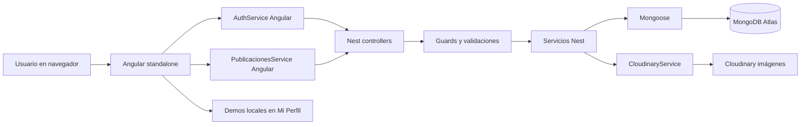
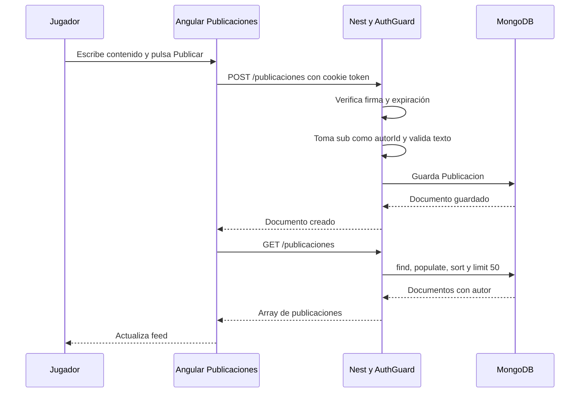

# 01 — Arquitectura

## Responsabilidades existentes

Como en un club, Angular es la recepción que muestra formularios; Nest es la oficina que revisa identidad y reglas; MongoDB es el archivo de fichas. Cloudinary guarda las fotografías y devuelve una dirección, no reemplaza la base de usuarios.

| Capa                  | Archivos reales                                                                       | Responsabilidad                                                                                                |
| --------------------- | ------------------------------------------------------------------------------------- | -------------------------------------------------------------------------------------------------------------- |
| Presentación          | `frontend/src/app/pages/`, `components/`, `app.routes.ts`                             | Formularios, navegación, estados de carga, mensajes y tarjetas.                                                |
| Comunicación Angular  | `frontend/src/app/services/auth.ts`, `publicaciones.ts`                               | HttpClient, observables y withCredentials donde hay sesión. Las URLs apuntan directamente a un backend Vercel. |
| Entrada HTTP          | `backend/src/main.ts`, controllers de auth, usuarios y publicaciones                  | CORS, ValidationPipe, routing, cuerpos y respuestas.                                                           |
| Seguridad transversal | `auth/guards/auth.guard.ts`, `common/middlewares/validar-origen.middleware.ts`        | Verificación JWT, AdministradorGuard de UsuariosModule para el listado y control parcial de origen.            |
| Reglas de negocio     | AuthService, UsuariosService, PublicacionesService de Nest                            | Hash, duplicados, selección de perfil, consultas y contenido de publicación.                                   |
| Persistencia          | `usuarios/entities/usuario.entity.ts`, `publicaciones/entities/publicacion.entity.ts` | Esquemas Mongoose, referencias ObjectId, índices declarados y timestamps.                                      |
| Imágenes              | `cloudinary/cloudinary.service.ts`                                                    | Transfiere un buffer de Multer a Cloudinary y devuelve secure_url.                                             |

No se ejecutaron escrituras contra servicios externos. Que las capas existan y compilen no demuestra el recorrido desplegado.

## Diagrama del estado actual

El guard se aplica solo donde está declarado: GET publicaciones y registro/login son públicos. El middleware de origen corre antes de los controllers para todas las rutas; omite GET/HEAD/OPTIONS.

## Ejemplo real: inscribir a una jugadora

1. Registro.registrar verifica el FormGroup y usa un flag enviando para evitar doble envío desde esa pantalla.
2. Construye FormData. Traduce `usuario` a `nombreUsuario`, `clave` a `password` y `repetirClave` a `repetirPassword`; el archivo viaja bajo `imagen`.
3. AuthService.registrar de Angular hace POST `/auth/registro`. HttpClient ejecuta la solicitud al suscribirse.
4. ValidarOrigenMiddleware revisa el Origin recibido; FileInterceptor deja el archivo en memoria y los pipes comprueban tipo/tamaño y el DTO.
5. AuthService.registrar de Nest comprueba coincidencia y genera bcrypt hash con costo 12.
6. Si hay imagen, CloudinaryService.subirImagen obtiene la URL. Luego UsuariosService.create verifica duplicados y guarda el documento con perfil `usuario`.
7. Se responde un mensaje y una proyección del usuario sin passwordHash. Angular muestra éxito/error. No se inicia sesión automáticamente.

**Límite encontrado:** la imagen se sube antes de verificar duplicados y guardar al usuario. Un rechazo posterior puede dejar un archivo sin usuario asociado. Documentado, sin cambiar el orden ni implementar compensación.

## Ejemplo real: publicar un entrenamiento de texto

Un 401 al publicar navega al login; otros errores muestran un mensaje. En éxito se limpia el control y se recarga el feed; todavía no hay mensaje explícito de publicación creada. Los mensajes de éxito/error exigidos para futuras bajas y comentarios se planifican, no están implementados.

## Modelos existentes y límites

- **Usuario:** nombre, apellido, correo único normalizado, nombreUsuario único, passwordHash excluido por defecto, fechaNacimiento, descripción, imagenPerfil, perfil usuario/administrador y timestamps. No hay campo de habilitación ni CV deportivo persistente.
- **Publicacion:** autorId referenciado a Usuario, contenido hasta 2000, multimediaUrl, tipoMultimedia y timestamps. No hay título, likes, comentarios ni estado de baja.
- **Dos interfaces Angular llamadas Publicacion:** `models/publicacion.ts` corresponde a demos con ids numéricos y contadores ficticios; `services/publicaciones.ts` al contrato API con _id y autor poblado. No son intercambiables. Se deberá adaptar la tarjeta, evitando duplicar reglas.
- **Referencia no equivale a integridad automática:** la existencia del usuario al crear una publicación no se consulta en PublicacionesService.crear; solo se verifica el formato de ObjectId y la firma previa. La baja/habilitación futura deberá contemplarlo.

## Organización a conservar y plan

Reutilizar UsuariosModule, AuthModule, SeguridadModule, PublicacionesModule y CloudinaryModule. SeguridadModule es infraestructura compartida, no una nueva funcionalidad de negocio. Angular sigue standalone, Nest conserva controllers/services y Mongoose sigue como acceso a MongoDB.

Comentarios necesitará responsabilidades propias exigidas por Sprint 3; su ubicación deberá seguir el enunciado oficial. Administración puede ampliar UsuariosModule y PublicacionesModule. Reportes pueden consultar esos modelos sin crear un módulo genérico adicional si el TP no lo solicita. Las rutas y nombres propuestos en los documentos siguientes son contratos pendientes de aprobación, no endpoints existentes.

## Cómo comprobar esta arquitectura

Las compilaciones constan en [08](08-PRUEBAS-Y-DESPLIEGUE.md). Para un recorrido real se necesita un entorno aislado con MongoDB y Cloudinary configurados, usuario de prueba, verificación de cookie en el navegador y consultas antes/después. No se hizo esa prueba ni se validó el despliegue. Conceptos a defender: separación de responsabilidades, inyección de dependencias, DTO frente a schema, Observable y suscripción, referencia ObjectId y API HTTP.

## Actualización de Tarea 2

GET usuarios usa la cadena AuthGuard → AdministradorGuard → UsuariosService.findById → validación del rol actual → UsuariosService.findAll con campos permitidos. El guard de rol pertenece a UsuariosModule para reutilizar su servicio sin introducir un ciclo de imports hacia SeguridadModule. No cambia la verificación de firma/expiración.

POST publicaciones usa CreatePublicacionDto en lugar de la interface. El ValidationPipe global existente puede validar esa clase; el servicio conserva su validación y guardado. Como en el club, revisar la ficha en recepción evita pasar un dato de tipo equivocado al encargado de registrar el parte. Ambos recorridos se probaron por HTTP local con almacenamiento simulado; no se ejecutaron escrituras externas.
